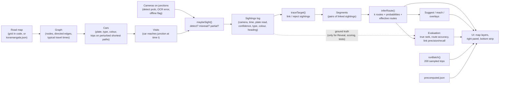

# 02 · System architecture

This page explains how the project is organised, what each module does, how data moves from the road map to the screen, and how the user interface keeps its state.

## 1. Folder structure

```text
TRAJEX/
├── index.html              HTML shell; loads src/main.tsx
├── package.json            npm scripts and dependencies
├── tsconfig.json           TypeScript settings (strict mode, no emit)
├── vite.config.ts          Vite + React plugin; vitest test file pattern
├── README.md               Short user-facing readme
├── SIMULATION_SPEC.md      Design brief (background only; where it differs from the code, the code is correct)
├── PROGRESS.md             Working notes (background only)
├── src/
│   ├── main.tsx            React entry point: renders <App/>
│   ├── sim/                The "world": maps, cars, cameras, sightings
│   │   ├── types.ts        Shared data types (Node, Edge, Camera, Car, Sighting…)
│   │   ├── rng.ts          Seeded random numbers and hashing
│   │   ├── graph.ts        Directed road graph + Dijkstra + A* helpers
│   │   ├── gridMap.ts      Generates the 8×8 "Grid city" map in code
│   │   ├── plates.ts       Plate generation, OCR mistakes, folding, matching
│   │   ├── engine.ts       The simulation engine (clock, cars, cameras, sightings)
│   │   ├── scenario.ts     buildEngine(): one way to build an engine, used by app and scripts
│   │   └── placement.ts    randomCameraNodes(): seeded random camera junctions
│   ├── track/              The "brain": reads sightings only
│   │   ├── link.ts         Links sightings to the tracked car; rejects look-alikes
│   │   ├── routes.ts       k-shortest paths, route scoring, entropy
│   │   ├── reach.ts        "Where could the car be now?" area
│   │   ├── suggest.ts      Best-next-camera and greedy placement
│   │   └── eval.ts         Batch evaluation, metrics, cameras-saved
│   └── ui/                 React user interface
│       ├── App.tsx         Top-level state and layout (left panel, centre, right, bottom)
│       ├── MapView.tsx     deck.gl map + animation loop
│       ├── RightPanel.tsx  Tracked-car panel (timeline, routes)
│       ├── BottomStrip.tsx Live metrics, batch results, chart
│       ├── CompareView.tsx Side-by-side random vs smart placement
│       ├── overlays.ts     Builds map layers for routes, reach, links, truth
│       ├── presets.ts      The 6 demo presets (data only)
│       ├── demoFacts.ts    Computes numbers for demo captions; precomputed-file helpers
│       └── styles.css      All styling
├── scripts/                Command-line tools (run with tsx / python)
│   ├── rehearse.ts         Headless check of all presets
│   ├── precompute.ts       Slow batch run → public/data/precomputed.json
│   ├── batch.ts            Run the batch evaluation on a map and print a table
│   ├── find_presets.ts     Search for scenarios that show each preset's message
│   └── export_osm.py       Download Koramangala roads from OpenStreetMap → JSON
├── tests/                  vitest unit tests (7 files, 38 tests)
├── public/data/
│   ├── koramangala.json    Bundled road network (1117 junctions, 3230 directed roads)
│   └── precomputed.json    Saved batch result used by preset 3 and the guided demo
├── cache/                  HTTP cache written by osmnx during map export (not used at run time)
├── dist/                   Production build output (created by npm run build)
└── docs/                   This documentation
```

Two rules shape the layout:

1. `src/sim/` knows nothing about `src/track/`. The world does not know that it is being tracked.
2. `src/track/` only reads **sightings** (and the road graph and camera list). It never reads a car's true route or the hidden `trueCarId`. Ground truth is exposed in separate engine functions (`trueEdgesBetween`, `trueNodesBetween`, `sightingsOf`) that are used only for the "Reveal true route" feature, for scoring, and for tests.

## 2. Every module and its job

| Module | Job (one sentence) |
|---|---|
| `src/sim/types.ts` | Defines the shapes of nodes, edges, cameras, cars, sightings and route hypotheses. |
| `src/sim/rng.ts` | `mulberry32` (a small seeded random generator), `hashInt`/`hash01` (turn numbers into repeatable pseudo-random values), and helpers `pick`, `range`, `randInt`. |
| `src/sim/graph.ts` | `Graph` class: stores the road network with integer indices; Dijkstra shortest paths, reverse distances for A*, point-along-edge, bearings. |
| `src/sim/gridMap.ts` | `makeGridMap()` builds the 8 × 8 test city. |
| `src/sim/plates.ts` | Makes Bengaluru-style plates, injects OCR mistakes, folds look-alike characters, and decides whether two plates match. |
| `src/sim/engine.ts` | `Engine` class: builds the cars, moves time forward, places cameras, produces the sightings log, and replays history when cameras change. |
| `src/sim/scenario.ts` | `buildEngine()` makes an engine from a plain settings object (used by the app, the demo facts and every script). |
| `src/sim/placement.ts` | `randomCameraNodes()` picks N random junctions with a seed. |
| `src/track/link.ts` | `traceTarget()` follows one car through the sightings: links, rejects (with reasons), and builds route segments. Also `InferenceCache`. |
| `src/track/routes.ts` | `kPaths()` (Yen's algorithm), `scorePath()`, `inferRoute()`, `effectiveRoutes()`. |
| `src/track/reach.ts` | `reachableEdges()` for the "Where now?" area. |
| `src/track/suggest.ts` | `bestCamera()` and `greedyPlacement()` using expected entropy. |
| `src/track/eval.ts` | `sampleTrips()`, `evaluatePlacement()`, `runBatch()`, `camerasSaved()`. |
| `src/ui/App.tsx` | Holds all user-interface state, creates the engine, runs the tracker on each render, and lays out the screen. |
| `src/ui/MapView.tsx` | Draws the map with deck.gl and runs the animation loop that advances the engine. |
| `src/ui/RightPanel.tsx` | Shows the tracked car, timeline of decisions, and ranked routes. |
| `src/ui/BottomStrip.tsx` | Shows live metrics, batch table, headline ("cameras saved") and the chart. |
| `src/ui/CompareView.tsx` | Builds two engines (random cameras, smart cameras) and shows two maps side by side. |
| `src/ui/overlays.ts` | Converts tracker output into deck.gl layers. |
| `src/ui/presets.ts` | The six demo presets as plain data. |
| `src/ui/demoFacts.ts` | Computes the facts behind each demo caption, writes the captions, and holds helpers for the precomputed file. |

## 3. Module dependency diagram

An arrow `A --> B` means "A imports B".

```mermaid
flowchart TD
  f_main["main.tsx"]
  subgraph sg_ui["src/ui"]
    f_App["App.tsx"]
    f_MapView["MapView.tsx"]
    f_RightPanel["RightPanel.tsx"]
    f_BottomStrip["BottomStrip.tsx"]
    f_CompareView["CompareView.tsx"]
    f_overlays["overlays.ts"]
    f_presets["presets.ts"]
    f_demoFacts["demoFacts.ts"]
  end
  subgraph sg_track["src/track"]
    f_link["link.ts"]
    f_routes["routes.ts"]
    f_reach["reach.ts"]
    f_suggest["suggest.ts"]
    f_eval["eval.ts"]
  end
  subgraph sg_sim["src/sim"]
    f_types["types.ts"]
    f_rng["rng.ts"]
    f_graph["graph.ts"]
    f_gridMap["gridMap.ts"]
    f_plates["plates.ts"]
    f_engine["engine.ts"]
    f_scenario["scenario.ts"]
    f_placement["placement.ts"]
  end
  f_scripts["scripts/*.ts"]
  f_tests["tests/*.test.ts"]
  f_main --> f_App
  f_App --> f_MapView
  f_App --> f_RightPanel
  f_App --> f_BottomStrip
  f_App --> f_CompareView
  f_App --> f_overlays
  f_App --> f_presets
  f_App --> f_demoFacts
  f_CompareView --> f_MapView
  f_CompareView --> f_overlays
  f_demoFacts --> f_presets
  f_link --> f_routes
  f_eval --> f_routes
  f_eval --> f_suggest
  f_scenario --> f_engine
  f_engine --> f_graph
  f_engine --> f_plates
  f_engine --> f_rng
  f_graph --> f_types
  f_plates --> f_rng
  f_placement --> f_rng
  f_placement --> f_graph
  f_App --> f_scenario
  f_App --> f_engine
  f_App --> f_graph
  f_App --> f_gridMap
  f_App --> f_plates
  f_App --> f_placement
  f_RightPanel --> f_plates
  f_RightPanel --> f_link
  f_BottomStrip --> f_eval
  f_overlays --> f_graph
  f_CompareView --> f_placement
  f_demoFacts --> f_placement
  f_demoFacts --> f_graph
  f_scenario --> f_graph
  f_engine --> f_types
  f_gridMap --> f_types
  f_link --> f_types
  f_routes --> f_types
  f_reach --> f_types
  f_suggest --> f_types
  f_App --> f_link
  f_App --> f_reach
  f_App --> f_eval
  f_App --> f_suggest
  f_App --> f_routes
  f_CompareView --> f_scenario
  f_CompareView --> f_eval
  f_CompareView --> f_link
  f_demoFacts --> f_scenario
  f_demoFacts --> f_link
  f_demoFacts --> f_routes
  f_demoFacts --> f_suggest
  f_demoFacts --> f_eval
  f_link --> f_plates
  f_link --> f_graph
  f_routes --> f_graph
  f_reach --> f_graph
  f_suggest --> f_graph
  f_eval --> f_graph
  f_eval --> f_rng
  f_MapView --> f_engine
  f_overlays --> f_link
  f_scripts --> sg_sim
  f_scripts --> sg_track
  f_scripts --> f_demoFacts
  f_tests --> sg_sim
  f_tests --> sg_track
  f_tests --> f_demoFacts
```



Notes:

- `src/track/*` imports only from `src/sim/graph`, `src/sim/plates`, `src/sim/rng` and `src/sim/types`. It never imports `engine.ts`, so it cannot ask the engine for the truth.
- `presets.ts` imports two *types* from `App.tsx` and `link.ts`. These imports disappear at build time, so there is no run-time cycle.

## 4. Full data flow



Step by step:

1. **Road map.** `makeGridMap()` or `public/data/koramangala.json` gives nodes (junctions) and edges (one-direction road pieces). `new Graph(map)` converts them into integer-indexed arrays and computes a typical travel time for each edge.
2. **Cars.** `Engine.buildCars()` creates the cars (plate, type, colour, speed factor). `Engine.newTrip()` gives each car a series of trips. A trip is a shortest path on randomly perturbed edge times. The result for each car is a list of **visits**: "this car arrives at node N at time `arr` and leaves at `dep`".
3. **Cameras.** `Engine.cameras` maps a node id to a `Camera` (detect probability, optional OCR error override, optional `offline` flag).
4. **Sightings.** When a visit happens at a node that has an online camera, `Engine.maybeSight()` decides if the camera detects the car and what plate text it reads. The result is a `Sighting` appended to `Engine.sightings`. If cameras or noise settings change, `rebuildLog()` regenerates the whole log from the stored visits.
5. **Tracker.** `traceTarget()` reads the sightings, links those that belong to the selected car, and rejects the others with reasons. It returns a `Trace` containing decisions and **segments** (pairs of consecutive linked sightings).
6. **Route inference.** For each segment `inferRoute()` returns ranked route hypotheses, `rawCount` (feasible routes) and `effective` routes.
7. **Evaluation.** If the user presses **Reveal**, `App.tsx` compares the hypotheses to the truth supplied by `Engine.trueNodesBetween()` and computes route accuracy, true-route rank and link precision/recall. `runBatch()` does the same on 200 sampled trips without the engine.
8. **UI.** `buildOverlays()` turns the trace into map layers; `RightPanel` and `BottomStrip` display the numbers.

## 5. How the application state is managed

There is no state library (no Redux). `App.tsx` uses React's `useState`, `useRef` and `useMemo`. The design has four parts.

### 5.1 The engine is a mutable object, not React state

- `const engine = useMemo(() => buildEngine(...), [seed, nCars, lookalikes, mapData, warm, nonce])` in `App.tsx`.
- The engine is rebuilt only when one of those six values changes. `nonce` is a counter that is bumped to force a fresh engine (for example when the same preset is clicked again).
- Changing cameras, noise or failures does **not** rebuild the engine. These call methods on the existing engine (`addCamera`, `setCameras`, `setNoise`, `failCamera`…), which replay the stored traffic.
- Because the engine is mutable, React does not notice when it changes. The map component calls `onTick` about every 250 ms, and `App` responds with `setTick(t => t + 1)` to force a re-render. After button actions that change cameras, `syncCams()` does the same.

### 5.2 Refs keep the camera set across engine rebuilds

`camNodes`, `camOcr` and `camFailed` are `useRef`s. They remember the camera junctions, per-camera OCR overrides and failed cameras. When the engine is rebuilt (for example the seed changes), the new engine is created with those cameras. `syncCams()` copies the engine's cameras back into the refs after every camera change.

### 5.3 Derived values are recomputed on each render

On every render `App` computes, in order:

1. `trace` (and `naiveTrace`) by calling `traceTarget()` for the selected car;
2. `reach` (if "Where now?" is on);
3. `trueEdges` (if Reveal is on);
4. `ov` from `buildOverlays()`;
5. `live` metrics.

The expensive part, route inference between two sightings, is cached by `InferenceCache` (key = sighting pair + camera set), so re-rendering four times per second is cheap.

### 5.4 Other state

| State | Where | Purpose |
|---|---|---|
| `mapMode`, `mapData`, `mapErr` | `useState` | Which map is loaded. Maps are cached in a module variable `mapCache`. |
| `seed`, `nCars`, `lookalikes`, `ocr`, `partial`, `miss`, `warm` | `useState` | Simulation settings. |
| `playing`, `speed` | `useState` | Clock control. |
| `selected`, `mode`, `reveal`, `showReach`, `search` | `useState` | Tracked car and its display options. |
| `sugg` | `useState` | Last suggestion, with a key. It is shown only if its key still matches the current cameras (`activeSugg`). |
| `batch` | `useState` | Batch progress and result (`BatchState`). |
| `demo`, `facts` | `useState` | Guided-demo step and the facts for the caption. `demoRef` mirrors `demo` for use inside the keyboard handler. |
| `presetId`, `compare`, `selCam` | `useState` | Highlighted preset, compare-view toggle, camera chosen in the "Fail a camera" list. |
| `wantSuggest`, `wantBatch` | `useState` | One-shot flags: a preset asks for a suggestion or a batch once the new engine exists. |
| `preCache` | module variable | Promise that loads `precomputed.json` once. |
| `modelCache` | `useRef` | Cached route models of sampled trips for suggestions and smart placement. |

### 5.5 URL parameters

At start-up `App.tsx` reads `?map=kor`, `?seed=`, `?warm=`, `?pause=1`, `?sel=<carId>`, `?reveal=1`, `?compare=1` and `?preset=N`. They are for debugging and for opening a preset directly.

## 6. Technology stack and why

| Technology | Version (package.json) | Why it is used |
|---|---|---|
| TypeScript | ^5.9.3 | Strict typing catches mistakes in the numeric code. `tsc --noEmit` is part of `npm run build`. |
| React + React DOM | ^18.3.1 | Simple component model for panels and controls. |
| Vite | ^5.4.21 | Fast dev server and production bundler; serves `public/` files as static data. |
| `@vitejs/plugin-react` | ^4.7.0 | JSX transform for Vite. |
| deck.gl (`core`, `layers`, `extensions`) | ^9.4.1 | WebGL drawing of thousands of road segments and moving cars at a good frame rate. `extensions` provides `PathStyleExtension` for the dashed "true route" line. No basemap tiles are used; roads are drawn from the JSON on a dark background, so the demo works offline. |
| Vitest | ^2.1.9 | Test runner that shares Vite's configuration. |
| tsx | ^4.23.15 | Runs the TypeScript scripts in `scripts/` directly from Node. |
| Python + osmnx 2.x (optional) | `.venv`, osmnx 2.0.7 | One-time download of the Koramangala road network from OpenStreetMap. Not needed at run time. |

There is no backend, no database and no network call at run time except loading two static JSON files from `public/data/`.

## 7. Performance design choices

- Integer indices and typed arrays (`Int32Array`, `Float64Array`) in `Graph` make shortest-path searches fast.
- `kPaths()` uses an exact A* heuristic (`Graph.distTo`) and Lawler's rule (only new spur points are explored) to speed up Yen's algorithm.
- `InferenceCache` stores segment inferences (up to 5000 entries, then it is cleared).
- Batch evaluation calls `yieldIfLong()` so the browser can repaint during long computations.
- The slow batch for preset 3 is **precomputed** and loaded from a file.
