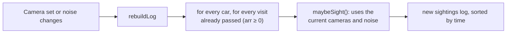

# 03 · How the simulation works

This page explains the "world" part of the project: everything in `src/sim/`. The world creates roads, cars, cameras and a list of sightings. The tracker (explained in [04-tracking-method.md](04-tracking-method.md)) then tries to make sense of that list.

Key terms used on this page:

- **Junction / node**: a point where roads meet. In the code, a `Node` with an `id`, `lat` and `lon`.
- **Edge**: one road piece going in **one direction** from one junction to the next. A two-way street is two edges.
- **Seed**: a whole number that starts a random-number generator. The same seed always gives the same random numbers.
- **Sighting**: one record created when a camera detects a car.

## 1. Road maps

The user can pick two maps. Both end up as the same data type, `MapData = { name, nodes, edges }` (`src/sim/types.ts`), and are wrapped by `new Graph(map)` in `src/sim/graph.ts`.

### 1.1 Grid city (`makeGridMap()` in `src/sim/gridMap.ts`)

A regular test city. It exists so the idea can be explained in 30 seconds.

| Property | Value |
|---|---|
| Junctions | 8 × 8 = **64** (ids `g<row>_<col>`, row 0 is the northern row) |
| Block length | **300 m** |
| Centre | latitude 12.935, longitude 77.626 (inside Koramangala) |
| Directed edges | **196** (of which 28 are one-way) |
| One-way streets | Rows 1 (east only) and 6 (west only); columns 2 (south only) and 5 (north only) |
| Arterial roads | Row 3 and column 4: highway type `primary`, **35 km/h** |
| One-way streets speed | **25 km/h** (`tertiary`) |
| All other streets | **20 km/h** (`residential`) |

The numbers 64, 196 and 28 were printed by running `makeGridMap()`.

### 1.2 Koramangala (`public/data/koramangala.json`)

A real piece of Bengaluru, taken from OpenStreetMap by `scripts/export_osm.py`.

| Property | Value |
|---|---|
| Bounding box | west 77.612, south 12.922, east 77.640, north 12.948 |
| Junctions | **1117** (ids `n0` … `n1116`) |
| Directed edges | **3230** (ids `e<number>`; 226 are one-way) |
| Total directed road length | about **306.9 km** |
| Road types (edge counts) | residential 2749, tertiary 225, secondary 105, primary 82, living_street 60, primary_link 8, busway 1 |
| File size | about 655 KB |

How the exporter builds it (see `scripts/export_osm.py`):

1. Download the OpenStreetMap "drive" network inside the bounding box with `ox.graph_from_bbox(..., network_type="drive")`. It retries on three public Overpass servers.
2. Project to metres, then **merge close junctions** with `ox.consolidate_intersections(tolerance=15, rebuild_graph=True, dead_ends=True)`. Complex junctions with several nodes within 15 m become one node.
3. Project back to longitude/latitude.
4. Keep only the **largest strongly connected component** (every junction can reach every other junction), so a car never gets stuck in a dead pocket.
5. Number nodes `n0…` and edges `e0…`, drop self-loops, and fix the first and last point of each edge geometry to the node positions.
6. Give each edge a speed: `motorway` 40, `trunk` 40, `primary` 35, `secondary` 30, `tertiary` 25 km/h, and 20 km/h for everything else. These are **city-traffic** speeds, not legal limits.

Because junctions are merged, two nodes can have more than one road between them. `Graph.edgeBetween(u, v)` returns the fastest one.

### 1.3 The graph and "typical time"

`Graph` (in `graph.ts`) turns the map into fast arrays:

- `out[node]` and `inn[node]`: edge indices leaving and entering a node.
- `eu[edge]`, `ev[edge]`: start and end node of an edge.
- `lengthM[edge]`: length in metres.
- `timeS[edge]`: **typical travel time** in seconds `= lengthM / (speedKph × 0.8 / 3.6)`.

The `0.8` is `TYPICAL_SPEED_FACTOR`. It is an assumption: typical traffic moves at 80 % of the road speed. The tracker uses `timeS` as its model of how long a road takes.

## 2. Cars

All cars are created in `Engine.buildCars()` (`src/sim/engine.ts`) using a generator seeded with `cfg.seed ^ 0xa5a5`.

| Property | How it is chosen |
|---|---|
| `id` | `car0`, `car1`, … |
| `plate` | `generatePlate()`: `KA` + an RTO code from `01, 02, 03, 04, 05, 41, 50, 51, 53` + two letters + four digits (1–9999, zero-padded). Example: `KA03VY9255`. Letters exclude I, O and Q (23 letters). |
| `type` | Uniform pick from `[car, car, car, suv, suv, auto, bike, bike, bus]`, so cars 3/9, SUVs 2/9, bikes 2/9, autos 1/9, buses 1/9. |
| `colour` | Uniform among 8 colours: white, black, silver, red, blue, yellow, green, grey. For `auto` the colour is re-picked from `[yellow, green, yellow]`. |
| `speedFactor` | Uniform between **0.6 and 1.0** (the car drives at this fraction of the road speed). |
| `departT` | Uniform between **−900 s and 0 s**, so cars are already on the road at time 0. |
| first node | `floor(hash01(seed, index, 77) × N)`, a random junction. |

Number of cars: the "Cars" slider, 20–300, default **150** (`DEFAULT_CONFIG.nCars`).

### 2.1 Look-alike cars

If "Look-alike plates" is on, each car `i ≥ 1` has a **5 %** chance to become a look-alike of an earlier car `j` (chosen at random). A look-alike:

- copies `type` and `colour` of the base car;
- gets a plate changed by `mutatePlate()` in **1 character (70 % of cases)** or **2 characters (30 %)**. The changed characters are in slots 3–9 (the first two letters "KA" and the first RTO digit are never touched), and each is replaced by another character of the same kind (digit for digit, letter for letter);
- stores the base car's id in `lookalikeOf`.

A look-alike is a trap for a tracker: it looks nearly the same on camera. The right-hand panel shows the chip "has a look-alike twin" for the car that was *created as* a look-alike (not for the base car).

### 2.2 Trips and routing

A car makes one **trip** after another, forever. In `Engine.newTrip()`:

1. A random **destination** junction is chosen (up to 8 attempts; at least 4 roads long for the first 7 attempts).
2. The route is the **shortest path** by Dijkstra on *perturbed* times: for every road, the typical time is multiplied by a random factor between **0.8 and 1.4**: `weight(e) = timeS[e] × (0.8 + 0.6 × hash01(seedT, e))`. The factor is different per trip and per road, so cars do not all pick the same "best" road. This is what creates route diversity, which is what the tracker must cope with.
3. The car then drives the route. On each road, travel time is `lengthM / (speedKph × speedFactor / 3.6)`. At each junction it waits a random **0–20 s** (`dep = arr + range(0, 20)`).
4. When the trip ends, the next trip starts from the same junction. (This is the "respawn".)

The car's drive speed (`speedKph × speedFactor`, factor 0.6–1.0, mean 0.8) is deliberately a little different from the tracker's model (`speedKph × 0.8`). The tracker therefore has to cope with cars that are faster, slower, or delayed.

Trips are generated lazily by `extend()`: the engine makes sure every car has at least 3 visits ahead and 300 s of plan beyond the current time.

The result for each car is a list of `Visit` records `{ seq, node, arr, dep, outEdge, trip }`. Position on screen is interpolated along the current road by `carPosition()`.

## 3. Plates and plate mistakes

All in `src/sim/plates.ts`.

### 3.1 Confusion pairs

Seven pairs of characters that an OCR engine often mixes up (`CONFUSION_PAIRS`): **0↔D, 8↔B, 5↔S, 2↔Z, 6↔G, 7↔T, 4↔A**. These are an assumption of the project, not measured data.

### 3.2 The three camera mistakes

| Mistake | Function | What it does |
|---|---|---|
| **OCR error** | `ocrSubstitute()` | Changes exactly one character. If some characters (from position 2 onwards) have a confusion partner, one of them is swapped for its partner. Otherwise a different character of the same kind is used. |
| **Partial read** | `partialRead()` | Replaces 2 or 3 random characters with `?`. |
| **Miss** | `maybeSight()` | The camera produces no sighting at all. |

### 3.3 Default values and ranges

Defaults come from `DEFAULT_CONFIG` in `engine.ts`. Sliders are in `App.tsx`.

| Setting | Default | Slider range | Where applied |
|---|---|---|---|
| OCR error rate (`ocrError`) | **15 %** | 0–60 % | `Engine.maybeSight()` |
| Partial read rate (`partialRate`) | **5 %** | 0–50 % | `Engine.maybeSight()` |
| Miss rate (`1 − detectProb`) | **10 %** (`detectProb = 0.9`) | 0–80 % | `Engine.maybeSight()` |
| Wrong vehicle type | 3 % | fixed | `Engine.maybeSight()` |
| Wrong colour | 3 % | fixed | `Engine.maybeSight()` |

Details of how `maybeSight()` produces one sighting (in order):

1. **Detection.** `hash01(key, 1) < cam.detectProb`, where `key = hashInt(seed, carIndex, visitSeq, 4242)`. If not, there is no sighting (a miss). Offline cameras never detect.
2. **Plate text.** Start with the true plate and a confidence drawn uniformly from **0.85–0.99**. Then draw two numbers `u` and `w`.
   - If `u < partialRate`: the plate is partly read, confidence drawn from **0.50–0.70**.
   - Otherwise, if `w < ocr`: one character is substituted, confidence drawn from **0.45–0.75**. Here `ocr` is the camera's own `ocrError` if it has one, otherwise the global value.
3. **Attributes.** With 3 % chance each, the vehicle type and the colour are replaced by a random one (the random pick can be the true value again).
4. **Heading.** The compass bearing (0° = north, clockwise) of the road the car takes **after** the camera junction.

Because the partial branch is checked first, the real fraction of fully-readable plates that get an OCR substitution is `ocr × (1 − partialRate)` (about 14.25 % with the defaults), not exactly the slider value.

A camera can have its own OCR rate (`Camera.ocrError`). Preset 4 uses this: junction `n52` has `ocrError = 1`, so it always misreads.

## 4. Camera detection

- A **camera** (`Camera` in `types.ts`) is attached to a junction: `{ id, nodeId, detectProb, ocrError?, offline? }`. Cameras are stored in `Engine.cameras`, a map from node id to camera.
- A camera sees a car **only at the junction**, at the moment the car arrives (`v.arr`). There is no field of view or road coverage.
- Detection probability is shared (set by the "Miss rate" slider) unless a camera overrides it.
- Each sighting contains: `id` (`s_<carIndex>_<visitSeq>`), `cameraId`, `nodeId`, time `t`, `plateRead` (string or null), `plateConf`, `type`, `colour`, `heading` and `trueCarId`.
- `trueCarId` is **hidden from the tracker**. It is kept only for scoring and for the "actually car X" labels shown after Reveal.

## 5. The simulation clock

- Time `engine.t` is in **seconds** since the start of the simulation.
- `Engine.step(dt)` advances the clock, makes sure trips exist, and walks each car's list of visits; every visit with `arr ≤ t` is passed through `maybeSight()`.
- Visits with `arr < 0` (the pre-roll of `departT`) never produce sightings.
- In the browser, `MapView.tsx` runs a `requestAnimationFrame` loop. Each frame it calls `engine.step(dtReal × speed)`, where `dtReal` is the elapsed real time capped at 0.1 s and `speed` is the slider value, **1× to 30×** (default 10×). Pause stops the stepping; the display continues.
- **Warm-up.** Before anything is shown, `buildEngine()` (`scenario.ts`) runs `eng.run(warm)` in 5-second steps, then rebuilds the log. The default `warm` is 900 s in the app and **1500 s** in all six presets, so a log of sightings already exists when the demo starts. The clock label `t = m:ss` shows this time.

## 6. Why runs are repeatable (the seed)

There is no use of `Math.random()` inside the simulation or the tracker. Everything comes from the seed:

- `mulberry32(seed)` (`rng.ts`) is a small, fast generator that always gives the same sequence for the same seed.
- `hashInt(...)` / `hash01(...)` mix several integers into one pseudo-random number. They are used where the result must **not depend on the order of events**:
  - the route of a car's trip `n`: seed `hashInt(seed, carIndex, tripNo, 991)`;
  - the speed perturbation of each road in that trip: `hash01(tripSeed, edge)`;
  - each camera decision: `hashInt(seed, carIndex, visitSeq, 4242)`.
- Because of this, the sightings do **not** depend on the step size. The test "is deterministic from the seed regardless of step size" (`tests/engine.test.ts`) compares a 5-second and a 1-second step and gets identical logs.
- Camera positions for "random" are also seeded: `randomCameraNodes(graph, n, seed)` uses `mulberry32(seed × 7919 + n)`.

One exception exists in the user interface: the **Random** button (`rerollCameras()` in `App.tsx`) adds `Math.random()` to the seed so each press gives a different set. That choice is intentional (it is a "re-roll"), but the resulting cameras are not repeatable unless you note them down.

## 7. Adding, removing and failing cameras ("what-if replay")

The engine stores every car's complete list of visits up to the current time. Because of this, when something about the cameras changes, it can **rebuild the sightings log from the beginning** with `Engine.rebuildLog()`:

Effects:

- **Add a camera** (`addCamera`, `toggleCamera`, map click): the new camera immediately has sightings for every car that already passed that junction. (Test: "adding a camera immediately yields sightings of cars that already passed it".)
- **Remove a camera** (`removeCamera`): its sightings disappear.
- **Replace all cameras** (`setCameras`): used by the count slider, the Random and Smart buttons.
- **Change noise** (`setNoise`) or **miss rate** (`setDetectProb`): rebuilds the log with new mistakes. Because mistakes are drawn from the same hash keys, small changes alter only the decisions near the threshold.
- **Fail a camera** (`failCamera`, `restoreCamera`, `toggleFail`): sets `Camera.offline`. An offline camera yields **no sightings in the entire replayed log**. This is a "what-if": *"if camera X had been down"*, not "X went down at the moment you clicked". Restoring brings back exactly the same log as before (tested).

Two lists matter:

- `engine.cameraList()` returns **online** cameras only. The tracker, negative evidence, the suggestion, the batch evaluation and the scripts all use this list, so a failed camera is treated as if it did not exist.
- `engine.allCameras()` returns all cameras including offline ones. It is used for drawing (an offline camera is a grey ring with a red ✕) and for keeping the camera set in sync.

Changing the camera count or pressing Random/Smart rebuilds the camera set from scratch with `setCameras()`, which creates fresh camera records. This clears the offline flags and per-camera OCR overrides. (See the list of observations in [10-viva-questions-and-limitations.md](10-viva-questions-and-limitations.md).)

## 8. Ground truth (for scoring only)

`Engine` offers three functions that expose the truth. The tracker never calls them.

| Function | Returns | Used by |
|---|---|---|
| `trueEdgesBetween(carId, t1, t2)` | The edges the car really drove between two times | The green dashed "true route" overlay. |
| `trueNodesBetween(carId, t1, t2)` | The junctions the car really visited | True-route rank and route accuracy after Reveal; `rehearse.ts`. |
| `sightingsOf(carId)` | All sightings this car really produced | Link precision/recall after Reveal; demo facts. |
