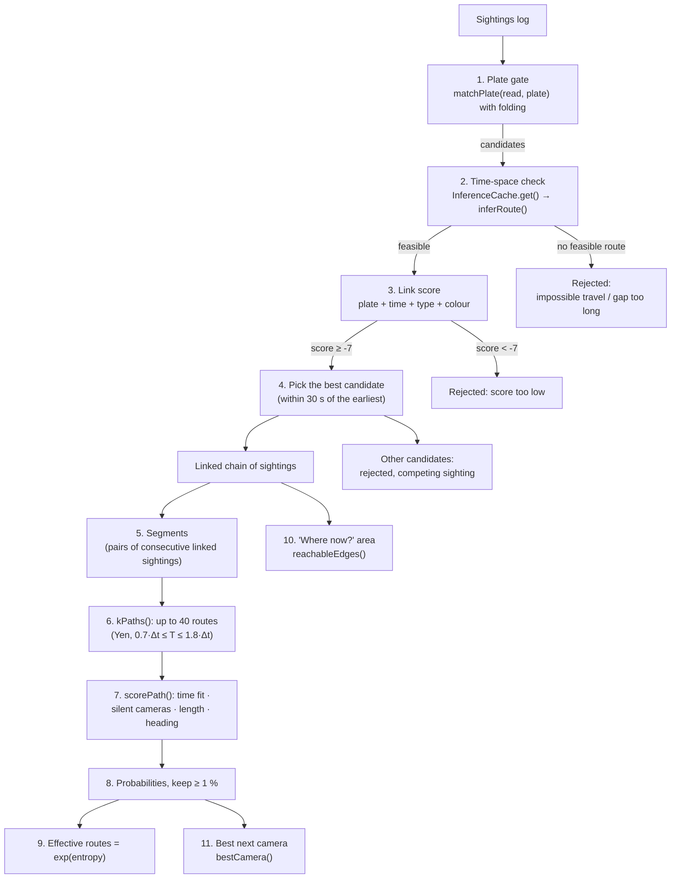

# 04 · The tracking method

This page explains the complete method used by the tracker in `src/track/` and `src/sim/plates.ts`. The tracker reads only three inputs:

1. the **sightings log** (`Engine.sightings`);
2. the **road graph** (`Graph`);
3. the **list of online cameras** (`Engine.cameraList()`).

It never reads a car's true route or `trueCarId`.

## 0. Overview



Terms used throughout:

- **Segment**: the stretch between two consecutive linked sightings A (at time `tA`) and B (at time `tB`). Its length in time is `Δt = tB − tA`.
- **Route** or **path**: a list of roads (edges) from A's junction to B's junction.
- **Typical time** `T` of a route: the sum of `Graph.timeS` over its edges.
- **Entropy**: a number that measures how spread out a probability list is. For probabilities `p₁ … pₙ`: `H = −Σ pᵢ · ln(pᵢ)`. It is 0 when one route is certain and large when many routes are equally likely.

---

## 1. Plate folding

Source: `fold()`, `foldedDistance()`, `matchPlate()` in `src/sim/plates.ts`.

**Folding** replaces every character with the representative of its confusion class. The seven classes are the pairs from section 3 of [03-how-the-simulation-works.md](03-how-the-simulation-works.md): the digit is the representative, so `D → 0`, `B → 8`, `S → 5`, `Z → 2`, `G → 6`, `T → 7`, `A → 4`. Characters that are not in a pair stay as they are.

Example from preset 4: the true plate is `KA01UG3544`; the camera read `KA01UG35A4`.

```text
fold("KA01UG3544") = "K401U63544"
fold("KA01UG35A4") = "K401U63544"      (A→4)
```

The folded strings are identical, so the **folded distance** is 0. Real code check: `matchPlate('KA01UG35A4','KA01UG3544')` returns `{ ok: true, kind: 'folded', dist: 0, known: 10 }`.

Folding is applied to every position, including the `KA` prefix. This is harmless because both strings are folded the same way.

`foldedDistance(a, b)` = Levenshtein edit distance (the minimum number of single-character insertions, deletions or substitutions that turn one string into the other) between `fold(a)` and `fold(b)`.

### `matchPlate(read, ref, maxDist = 1)`

| Case | Rule | Result `kind` |
|---|---|---|
| `read` is `null` | not a match | `none` |
| `read` contains `?` (partial read) | Lengths must be equal. Count the known (non-`?`) characters. Each known character must equal the reference character **after folding**. Match only if there are **0 disagreements and at least 6 known characters** (`MIN_PARTIAL_KNOWN`). | `partial` |
| `read === ref` | match | `exact` |
| otherwise | `d = foldedDistance(read, ref)`. Match if `d ≤ maxDist` (the tracker uses 1). | `folded` if `d = 0`, `near` if `d = 1`, else `none` |

The unit tests in `tests/plates.test.ts` check each rule.

---

## 2. Candidate filtering and the first sighting

Source: `traceTarget()` in `src/track/link.ts`.

The operator selects a car. The tracker uses that car's **plate, type and colour** as the target.

1. `close` = all sightings for which `matchPlate(s.plateRead, target.plate, 1).ok` is true. These are the **candidates**. Sightings with clearly different plates are not shown at all.
2. The **first sighting** is the earliest candidate with distance 0 that is not partial. If there is none, the earliest distance-0 candidate (partial allowed). If there is none, the earliest candidate.
3. If there are no candidates, the trace is empty and the panel says "No sighting of this plate yet".

---

## 3. The link loop

Starting from the first sighting, the tracker repeats the following until no candidate is left (at most 200 iterations). Let `last` be the most recently linked sighting.

For each unlinked candidate `s` with `s.t > last.t`, taken in time order:

### 3.1 Time-space check (travel feasibility)

`dt = s.t − last.t`. The tracker asks `InferenceCache.get(g, last, s, cameras)` for the segment inference. Inside:

- If `last` and `s` are at the **same junction**: feasible only if `dt ≥ 60 s` (a car looping round the block). Then `rawCount = 1`, `effective = 1`.
- Else compute `minT`, the fastest typical time from `last`'s junction to `s`'s junction (Dijkstra on `timeS`). If `minT > 1.8 × dt`, there is no feasible route: `rawCount = 0`.
- Else call `inferRoute()` (section 5). If it finds no route with `0.7·dt ≤ T ≤ 1.8·dt`, `rawCount = 0`.

If `rawCount = 0` the candidate is **rejected**, with one of three reasons (exact wording from the code):

| Condition | Reason text |
|---|---|
| Same camera again within 60 s | `impossible: same camera again after only N s` |
| `minT < 0.7 × dt` (the car had far more time than the fastest route needs) | `gap too long for one trip: fastest route from <node> is X s but N s elapsed (car stopped / made other trips)` |
| otherwise (`minT` too large) | `impossible travel: fastest route from <node> needs X s, only N s elapsed` |

### 3.2 Link score

If there is a feasible route, the tracker computes a **score**. It is a sum of log-likelihood terms. (A *log-likelihood* is the natural logarithm of "how likely is this evidence if it is the same car". Adding logs is the same as multiplying probabilities.)

```text
score = plateLL + timeLL + typeLL + colourLL
```

**Plate term** (`plateLL()` in `link.ts`):

| Match kind | Formula |
|---|---|
| `exact` or `folded` | `ln(max(0.05, conf))` where `conf` is the camera's confidence for this sighting |
| `partial` | `ln(0.5) + ln(known / 10)` |
| `near` (folded distance 1) | `ln(max(0.02, 1 − conf) × 0.3)` |

**Time term**: `timeLL = −bestFitErr² / (2σ²)`, with `σ = 0.25 × dt` and `bestFitErr = min over feasible routes of |T − dt|`. It is 0 when some route matches the observed time exactly, and gets more negative when even the best route is far off.

**Type term**: `ln(0.97)` if the type matches, else `ln(0.03 / 4)`.

**Colour term**: `ln(0.97)` if the colour matches, else `ln(0.03 / 7)`.

If `score < LINK_THRESHOLD = −7` the candidate is **rejected** with `score too low (x): type differs; colour differs; <plate note>`.

### 3.3 Choosing the link

Candidates that pass are collected. To avoid evaluating the whole future at once, the loop stops reading candidates once it has passed `stopT = (time of first passing candidate) + 30 s`.

- Sort the passing candidates by time. Take all within **30 s** of the earliest one (the "group").
- The one with the **highest score** is linked. The others in the group are rejected with `competing sighting at same time scored lower (x vs y)`.
- `last` becomes the linked sighting and the loop repeats.

The linked sighting's reason text is `<plate note>; travel time fits (N feasible routes)`. Plate notes: `exact plate`, `plate matches after folding O/D, 8/B…`, `partial read agrees on K slots`, `plate 1 char off`.

Every sighting that passed the plate gate ends with exactly one status in the timeline: ✓ linked or ✗ rejected (with reason). A rejected candidate can be re-evaluated against a newer `last`, and the final reason is the last one computed.

### 3.4 Real example of a link score (preset 1)

The tracked car `car38` (plate `KA03VY9255`, grey car). First sighting: junction `n293` at t = 1158.3 s. Second sighting: `n73` at t = 1320.0 s, read exactly as `KA03VY9255` with confidence 0.931. `dt = 161.7 s`, so `σ = 40.44 s`. `bestFitErr = 0.1 s`.

```text
plateLL  = ln(0.931)                    = -0.0715
timeLL   = -(0.1)² / (2 × 40.44²)       = -0.000003
typeLL   = ln(0.97) (car = car)         = -0.0305
colourLL = ln(0.97) (grey = grey)       = -0.0305
score    = -0.1325   → shown as -0.13
```

This matches the value in the timeline: `linked … score -0.13: exact plate; travel time fits (40 feasible routes)`.

### 3.5 Real example of a rejection (preset 5)

Target `car6`, a blue bike, plate `KA05YE0047`, seen at `n221` at t = 102 s. A twin `car7` with plate `KA05YL0047` (one letter different) is seen at `n64` 48 s later. The plate gate passes it (distance 1). The fastest typical route from `n221` to `n64` takes 369 s, more than `1.8 × 48 = 86 s`, so no route is feasible:

```text
rejected  n64  KA05YL0047  :: impossible travel: fastest route from n221 needs 369 s, only 48 s elapsed
```

The same scenario shows a second rejection: `car26` (`KA06YE0047`) at `n64` at t ≈ 1324 s: `gap too long for one trip: fastest route from n219 is 380 s but 1019 s elapsed`.

---

## 4. Naive mode (for comparison)

`traceTarget(..., mode = 'naive', ...)` links **every sighting whose `plateRead` is exactly equal to the target plate**, with the reason "exact plate string match". It does no folding, no time check and no scoring. It is a deliberately simple baseline, like a plain database search.

Preset 4 shows the difference: the car was seen 3 times; the middle camera read `KA01UG35A4`. Our method links 3 sightings (middle score −0.77, plate-note "folded"); naive links 2 (`n481>n601`).

Weakness of naive mode in the other direction: it cannot be fooled by a near-miss plate, but it also never checks travel time, so if another car had the exact same plate it would be linked. In this simulation plates are unique except for look-alikes that differ by at least one character, so naive mode essentially never links the wrong car; its problem is missed links.

---

## 5. Route inference between two linked sightings

Source: `inferRoute()`, `kPaths()`, `scorePath()` in `src/track/routes.ts`.

Input: start junction `a`, end junction `b`, times `tA`, `tB`, the camera map (junction → detection probability), and the heading of the first sighting `headingA`. Let `dt = tB − tA`. If `dt ≤ 0` or `a = b`, the result is empty.

### 5.1 Step 1 — K shortest loop-free paths (`kPaths`)

The algorithm is **Yen's k-shortest paths**. It first finds the shortest path (by typical time), then repeatedly finds the next best path that differs from all earlier ones. Paths have no loops (no junction twice).

Settings used: `minT = 0.7 × dt`, `maxT = 1.8 × dt`, `K = 40`, `maxGen = 150`.

How it works in this code:

1. `h = g.distTo(dst)` gives the exact shortest time from every junction to the destination. It is used as an **A\* heuristic** so each search goes straight toward the target.
2. Find the first shortest path. If its time is above `maxT`, return nothing.
3. For the latest accepted path, for each position `i` along it (starting at its *deviation point* — this is **Lawler's rule**: positions before that were already explored), make a **spur**: keep the first `i` roads (the *root*), block the roads that earlier accepted paths with the same root used next, block the root's junctions, and run A* from the spur junction to the destination. Root + spur is a candidate path.
4. Put new candidates in a pool `B`. Take the cheapest from `B` as the next accepted path. Stop when its time exceeds `maxT`, or when `K` accepted paths have `T ≥ minT`, or after `maxGen = 150` accepted paths.
5. Return the accepted paths with `minT ≤ T ≤ maxT`, at most `K`.

Paths faster than `0.7 × dt` are skipped because the car would have had to drive much faster than its typical speed. Paths slower than `1.8 × dt` are skipped because they cannot fit the observed time. The window comes from the design brief and is deliberately wide because cars have speed factors from 0.6 to 1.0 and random junction delays.

`rawCount` = number of paths returned (at most 40). This is the "**feasible**" count in the UI.

### 5.2 Step 2 — Score every path (`scorePath`)

For each path with typical time `T`:

```text
score = timeFit × silentCameras × lengthPreference × headingPenalty
```

| Term | Formula | Meaning |
|---|---|---|
| **Time fit** | `exp( −(T − dt)² / (2σ²) )`, `σ = 0.25 · dt` | A bell curve: routes whose typical time equals the observed time score 1; routes 25 % off score `exp(−0.5) ≈ 0.61`; routes 50 % off score `exp(−2) ≈ 0.14`. |
| **Cameras that did not see the car** (negative evidence) | `Π (1 − p)` over every junction in the **interior** of the path that has an online camera, where `p` is that camera's detection probability | If the car had taken this route it would have passed those cameras, and each would have seen it with probability `p`. Since none did, the route is less likely. With `p = 0.9` each silent camera multiplies the score by 0.1. |
| **Length preference** | `exp( −0.1 · extraKm )`, `extraKm = (length − shortest length among the candidates) / 1000` | A mild preference for shorter roads: each extra kilometre multiplies the score by 0.905. |
| **Heading penalty** | `0.15` if the bearing of the path's **first** road differs from `headingA` by more than 60°, else 1 | The first camera recorded the direction in which the car was heading. A route that begins in a very different direction is unlikely (not impossible, because the car could turn). |

The first three terms are computed by `scorePath()` (tested in `tests/routes.test.ts`); the heading penalty is passed in as `headingPenalty`.

Only cameras in the interior of the route count (not the two end junctions). Offline cameras are not in the camera map, so they never produce negative evidence.

### 5.3 Step 3 — Probabilities and pruning

1. `probs = normalise(scores)`: divide each score by the sum, so the probabilities add up to 1.
2. Keep routes with `prob ≥ 0.01` (1 %). If none qualifies, keep the single best one.
3. Normalise again over the kept routes.
4. Sort by probability, highest first. These are the **route hypotheses** (`RouteHypothesis`: `edgeIds`, `nodeIds`, `travelTimeS`, `prob`).

### 5.4 Step 4 — Effective number of routes

```text
H         = − Σ pᵢ · ln(pᵢ)         (entropy of the kept probabilities)
effective = exp(H)
```

How to read it:

| Situation | `effective` |
|---|---|
| 4 routes with 25 % each | 4.0 |
| 1 route with 100 % | 1.0 |
| 2 routes with 90 % and 10 % | 1.38 (less than 2 because one route dominates) |

The tests in `tests/routes.test.ts` check these values. The UI shows both numbers: "N feasible" (`rawCount`) and "≈ X effective routes".

The result object also stores `bestFitErr` (smallest `|T − dt|` over all feasible paths) and `minTimeS` (fastest feasible time). The link step uses both.

### 5.5 Worked example with real numbers (preset 1)

Scenario: Koramangala, seed 2026, cameras `n293` and `n73` only, OCR 10 %, partial 3 %, miss 10 %, 150 cars, 1500 s warm-up. Tracked car `car38`.

**Input to the segment**

- A = `n293` at tA = 1158.3 s; the camera saw it heading **228.9°** (roughly south-west).
- B = `n73` at tB = 1320.0 s.
- `Δt = 161.7 s`, `σ = 0.25 × 161.7 = 40.44 s`.
- The window is `0.7 × 161.7 = 113.2 s` to `1.8 × 161.7 = 291.1 s`.
- The fastest typical route takes `minT = 123.6 s`.

**Step 1 — K paths.** `kPaths` returns **40 paths** (the maximum K). So `rawCount = 40`.

**Step 2 — Scores.** There are no other cameras on any path (only the two end cameras exist), so the negative-evidence term is 1 for every path. Heading: **32 of the 40 paths** start in a direction more than 60° from 228.9°, so they are multiplied by 0.15. Sum of all 40 scores `Z = 10.328`.

The eight best-scoring paths (computed by calling the real `kPaths` and `scorePath`):

| Rank | Typical time T | Length | Time fit | Length factor | Heading factor | Score | Share of all 40 |
|---|---|---|---|---|---|---|---|
| 1 | 161.6 s | 830 m | 1.000 | 0.9777 | 1 | 0.9777 | 9.47 % |
| 2 | 170.8 s | 844 m | 0.975 | 0.9762 | 1 | 0.9518 | 9.22 % |
| 3 | 174.8 s | 888 m | 0.949 | 0.9719 | 1 | 0.9223 | 8.93 % |
| 4 | 177.1 s | 898 m | 0.930 | 0.9710 | 1 | 0.9034 | 8.75 % |
| 5 | 184.0 s | 903 m | 0.859 | 0.9705 | 1 | 0.8338 | 8.07 % |
| 6 | 193.9 s | 947 m | 0.729 | 0.9663 | 1 | 0.7039 | 6.82 % |
| 7 | **123.6 s** | **634 m** | **0.641** | 0.9969 | 1 | **0.6392** | 6.19 % |
| 8 | 201.5 s | 1137 m | 0.616 | 0.9480 | 1 | 0.5842 | 5.66 % |

(The shortest of the 40 candidate routes is 603.7 m; "length factor" is `exp(−0.1 × extra km)` relative to it. None of these eight starts more than 60° away from 228.9°, so none was hit by the heading penalty. A penalised route scores at most 0.15, so all 32 of them rank below these eight.)

Rank 1, by hand: time fit `exp(−(161.6 − 161.7)² / (2 × 40.44²)) ≈ 1.0000`; extra length `(830 − 603.7)/1000 = 0.226 km` so `exp(−0.0226) = 0.9777`; no silent cameras; heading penalty 1. Score = 0.9777. ✔

Rank 7, by hand: time fit `exp(−(123.6 − 161.7)² / (2 × 40.44²)) = exp(−0.444) = 0.641`; extra length `(634.3 − 603.7)/1000 = 0.031 km` → `0.9969`; score `0.641 × 0.9969 = 0.639`, matching the program's 0.6392. ✔

**Step 3 — Probabilities.** Four of the 40 routes have a share below 1 % (the lowest score is 0.078, i.e. 0.76 %). They are dropped, the rest renormalised: **36 routes kept**. The final top shares are 9.8 %, 9.6 %, 9.3 %, 9.1 % and 8.4 %.

**Step 4 — Effective routes.** Entropy `H = 3.1449`; `exp(3.1449) = 23.22`. So the tracker reports "40 feasible, ≈ 23.2 effective routes".

**Ground truth check (after Reveal).** The car really took the **fastest** route on paper (typical time 123.6 s, 6 roads). That route was ranked **7th**, with probability **6.42 %**. The reason is in the time model: the car's speed factor was 0.85, close to the typical 0.8, so its driving time was 116.2 s, but the simulation adds a random 0–20 s wait at every junction, and the car spent 45.6 s waiting (the waits at the first six of the seven junctions on the true route, `n293` … `n464`; there is no wait before the sighting at `n73`). The observed time between the two sightings was 161.7 s. The tracker's model has no junction waits, so it considers the roads whose typical time is close to 162 s more likely than the fastest road. This is honest behaviour: with only two cameras there is not enough information, and the top guess is wrong.

**What a third camera does (preset 2).** The suggestion rule (section 8) proposes junction `n231`. After adding it the same car is sighted at `n293` (t = 1158 s) → `n231` (t = 1225 s) → `n73` (t = 1320 s):

| Segment | Feasible routes | Effective routes | Top route probability | True-route rank |
|---|---|---|---|---|
| n293 → n231 | 8 | 2.05 | 75.1 % | 1 |
| n231 → n73 | 11 | 3.99 | 61.1 % | 1 |

---

## 6. "Where could it be now?" area

Source: `reachableEdges()` in `src/track/reach.ts`.

After the last linked sighting, the car may be anywhere it could have reached since. The function:

1. Runs Dijkstra from the last camera's junction on typical times with `maxCost = 1.25 × elapsed` (the `1.25` is a safety margin: the fastest car, speed factor 1.0, is 1.25 times faster than the typical 0.8).
2. Marks **every camera junction as "do not expand"**. The search may reach a camera junction but cannot continue beyond it. The reasoning: if the car had gone through a camera, that camera would have reported it.
3. Returns every edge whose start junction is reachable within `maxCost` and is either the start itself or not a camera.

In the app, the elapsed time is `engine.t − lastLinked.t`, so the area grows as the clock runs and shrinks (or vanishes) when a new sighting extends the chain. It is drawn as a cyan haze. In preset 1, 120 s after the last sighting the area covers 353 of the 3230 roads; 300 s after it covers 2792.

This treats cameras as perfect blockers (it ignores `detectProb`), so it is a simplification compared with the route scoring, which accounts for missed detections.

---

## 7. Putting segments together

`traceTarget()` ends by building `segments`: for consecutive linked sightings `(linked[i], linked[i+1])` it calls `cache.get()`, which runs the inference above (cached by sighting pair and camera set). The interface shows, per segment, up to 5 routes with their probabilities, travel times and number of roads.

## 8. Using the same machinery to advise camera placement

The same route probabilities feed the suggestion rule in `src/track/suggest.ts`. That is explained, with a worked example, in [05-camera-placement-and-evaluation.md](05-camera-placement-and-evaluation.md).

## 9. Cheat sheet of constants

| Constant | Value | Where |
|---|---|---|
| Plate edit distance allowed | 1 (after folding) | `matchPlate(..., maxDist = 1)` |
| Minimum known characters for a partial read | 6 | `MIN_PARTIAL_KNOWN` in `plates.ts` |
| Link threshold | −7 | `LINK_THRESHOLD` in `link.ts` |
| Competing-sighting group window | 30 s | `traceTarget()` |
| Same-camera return minimum | 60 s | `InferenceCache.get()` |
| Travel window | 0.7·Δt … 1.8·Δt | `inferRoute()`, `InferenceCache.get()` |
| Number of routes `K` | 40 (max 150 generated) | `kPaths()` |
| Time-fit spread σ | 0.25·Δt | `scorePath()` and `traceTarget()` (`timeLL`) |
| Length preference | 0.1 per extra km | `scorePath()` |
| Heading penalty | ×0.15 beyond 60° | `inferRoute()` |
| Route kept if probability | ≥ 1 % | `inferRoute()` |
| Type / colour agreement | 0.97 vs 0.03/4 and 0.03/7 | `traceTarget()` |
| Typical speed factor | 0.8 | `TYPICAL_SPEED_FACTOR` in `graph.ts` |
| Reach speed margin | 1.25 | `reachableEdges()` |
