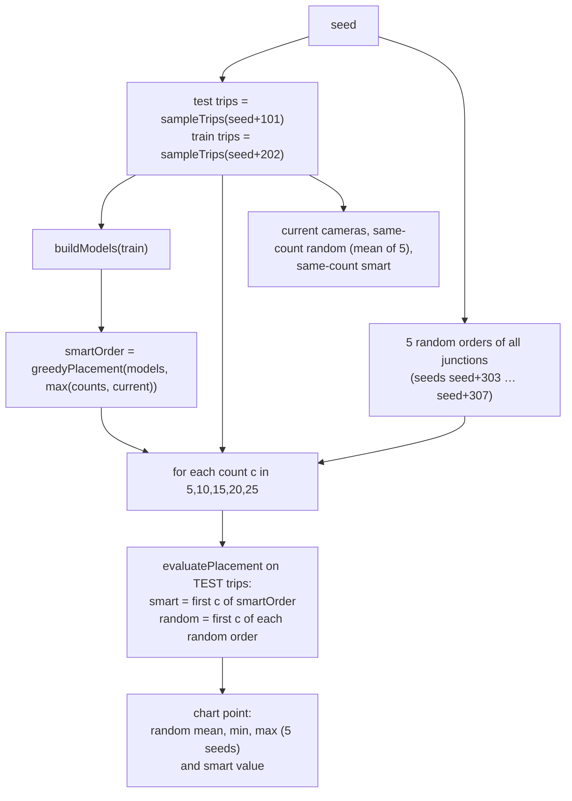

# 05 · Camera placement and evaluation

This page explains how the project decides **where a new camera should go**, how it compares **smart** and **random** placement, and how it measures the result. Source files: `src/track/suggest.ts`, `src/track/eval.ts`, `scripts/precompute.ts`, `src/ui/demoFacts.ts`.

Terms:

- **Nat**: the unit of entropy when the natural logarithm is used. (3.14 nats of entropy ≈ `exp(3.14)` = 23 effective routes.)
- **Segment**: a stretch between two observed points of a trip, where the exact road is unknown.
- **Batch**: many simulated trips evaluated together.

---

## 1. The best-next-camera suggestion

### 1.1 The idea

For a segment with several possible routes, a new camera on a junction helps if **some routes pass through it and others do not**. After the camera reports "seen" or "not seen", the list of possible routes gets shorter, so uncertainty (entropy) falls. A junction on **all** routes or on **none** adds nothing. A junction on about **half** the probability mass helps most.

### 1.2 The model of one segment: `SegModel`

`modelFromHyps()` turns the route hypotheses of a segment into

```ts
type SegModel = { paths: { nodes: number[]; w: number }[] }
```

- `nodes` = the **interior** junctions of the route (without start and end).
- `w` = the route's probability.

### 1.3 Weights and entropy

`weights(m, S)`: `S` is the set of **existing** cameras (junction → detection probability). For each route, multiply its `w` by `(1 − d)` for each existing camera on it. This is the negative-evidence rule: the car was not reported there.

`H(weights)` = entropy of the normalised weights.

### 1.4 Expected entropy after adding a camera at junction `j`

`expectedEntropyAfter(m, S, j, p)` with detection probability `p`:

1. Split the routes into **pass** (go through `j`) and **notPass**. Let `wp` and `wn` be their total weights and `z = wp + wn`.
2. If either group is empty, the camera cannot split anything: return the current entropy.
3. Probability that the camera reports the car: `pSeen = p × wp / z`.
4. **If seen**: only the pass routes remain: entropy `Hseen = H(pass)`.
5. **If not seen**: pass routes are down-weighted by `(1 − p)`, notPass keep their weight: `Hsilent = H([pass × (1 − p), notPass])`.
6. Expected entropy: `pSeen × Hseen + (1 − pSeen) × Hsilent`.

The tests confirm the extreme cases: a perfect camera (`p = 1`) on one of two equal routes brings the entropy to 0; a blind camera (`p = 0`) changes nothing.

### 1.5 Choosing the junction: `bestCamera()`

```ts
bestCamera(g, models, S, p, exclude = new Set())
```

- For every segment model, compute its current entropy `h0` and the gain `h0 − expectedEntropyAfter(…)` for **each candidate junction**. A candidate is any junction that lies in the interior of at least one route, has no camera yet (`!S.has(n)`), and is not in `exclude`.
- Add the gains up over all segment models.
- Return the junction with the largest total gain, with
  - `gain` in nats,
  - `baseEntropy` = sum of the current entropies,
  - `gainPct = 100 × gain / baseEntropy` (this is the "+X % certainty" shown in the interface).
- Return `null` if no junction has a positive gain.

`exclude` is used for failed cameras: the failed junction is never proposed as its own replacement.

### 1.6 Worked example (preset 1, real numbers)

Segment `n293 → n73` of `car38`; cameras on `n293` and `n73`; detection probability `p = 0.9`.

- 36 kept routes; current entropy **3.1449 nats** (= 23.22 effective routes).
- Best junction: **`n231`**. 19 of the 36 routes pass through it, and they hold **55.1 %** of the probability mass (`wp = 0.5510`, `wn = 0.4490`).
- `pSeen = 0.9 × 0.5510 = 0.4959`.
- `Hseen = 2.4917`, `Hsilent = 2.7678`.
- Expected entropy after = `0.4959 × 2.4917 + 0.5041 × 2.7678 = 2.6309`.
- Gain = `3.1449 − 2.6309 = 0.5140` nats → `0.5140 / 3.1449 = 16.34 %` → shown as "+16 % certainty".

This is an *expected* improvement. The real improvement for this car happens to be much larger, because the car did pass `n231` and the camera saw it: after adding the camera, the two pieces have 2.05 and 3.99 effective routes (see [04-tracking-method.md](04-tracking-method.md), section 5.5).

### 1.7 What the suggestion is based on

`doSuggest()` in `App.tsx`:

- If a car is tracked and has at least one segment: the models are built from **that car's segments** (route inference re-run with an empty camera map so that `S` supplies the negative evidence once). The card says "over the tracked car's ambiguous segments".
- Otherwise: the models are built from **sampled trips** (`sampleModels()`): 80 trips on Koramangala (more than 200 junctions) or 150 trips on the grid, with `seed + 202`, and the shortest allowed trip is 8 roads on Koramangala, 6 on the grid. The card says "over sampled trips".

The suggested junction is drawn as a pulsing yellow ring; **Add suggested camera** calls `engine.addCamera(node)`.

---

## 2. Greedy "smart" placement: `greedyPlacement()`

```ts
greedyPlacement(g, models, k, p, existing = [])
```

It chooses cameras **one at a time**: call `bestCamera()`, remember the result, add it to `S` as if a camera were there, and repeat `k` times. It stops early if no junction gives a gain. The list order is the pick order, so the first `c` entries are the smart placement for `c` cameras.

This is a **greedy** method: each step chooses the best camera given the earlier ones. It does not guarantee the globally best set, but it is fast and gives good results.

What it optimises: the models for placement come from `buildModels()` (see section 3.2): the uncertainty of **whole trips from origin to destination, with no cameras at all**. In other words, it chooses junctions that lie on many plausible routes of many different trips.

**Smart button** (`smartPlace()` in `App.tsx`): replaces the current cameras with `greedyPlacement()` for the same number of cameras, using the sampled models and `p = 1 − miss rate`.

**Random button** (`rerollCameras()`): replaces the cameras with the same number of random junctions.

---

## 3. Batch evaluation

### 3.1 What a simulated trip is: `sampleTrips()`

```ts
sampleTrips(g, n, seed, minEdges = 6, maxEdges = 40): Trip[]
```

A `Trip` has `nodes`, `edges`, arrival times `arr` and the first-road headings `heading0`. Each trip is made like a car's trip in the engine: random origin and destination, shortest path on perturbed times (factor 0.8–1.4), speed factor 0.6–1.0, a 0–20 s wait at every junction. Trips shorter than `minEdges` or longer than `maxEdges` roads are skipped. These trips live in `eval.ts`, **not** in the engine: the batch does not run the live traffic.

### 3.2 Models for placement: `buildModels()`

For each trip: `inferRoute()` from its origin to its destination with **no cameras**, and only if hypotheses exist, `modelFromHyps()`. On the Koramangala training set (seed 2026, 200 trips) this gives 122 models; for the other 78 trips the inference returns no routes (in those trips the fastest typical route takes 0.4–0.67 of the real elapsed time, mean 0.57, because the car was slow, and the time window then asks for detours which the search does not return).

### 3.3 Evaluating a placement: `evaluatePlacement()`

```ts
evaluatePlacement(g, trips, cameraNodes, p, seed): EvalResult
```

For each trip:

1. The trip is **observed** at its start (index 0), at its end, and at each interior junction that has a camera **and** where a pseudo-random draw `hash01(seed, tripIndex, node, 9) < p` says the camera detected the car.
2. Consecutive observed points form **segments**. For each segment, `inferRoute(i → j)` is run with all cameras in the camera map (so silent cameras count as negative evidence) and the heading of the first road.
3. Segments with no hypotheses are skipped. For the others, the following are recorded:
   - `effective` and `rawCount` of the inference;
   - the **rank** of the true route (found by comparing junction sequences) if it is among the hypotheses;
   - **route accuracy**: `routeShare()` = the share of the true route's road length (counted per junction pair) that also lies on the top-ranked hypothesis.

Result fields (`EvalResult`):

| Field | Meaning |
|---|---|
| `cameras` | number of cameras in the placement |
| `trips`, `segments` | number of trips and of segments that had at least one route |
| `avgRoutes` | **mean effective routes per segment** (the main metric; lower is better) |
| `avgFeasible` | mean number of feasible routes per segment |
| `routeAccuracy` | mean route share of the top-1 hypothesis |
| `meanRank` | mean rank of the true route over the segments where it was found |
| `foundPct` | % of segments where the true route was among the hypotheses |
| `top1Pct` | % of segments where the true route is ranked first |

### 3.4 The whole batch: `runBatch()`

```ts
runBatch(g, current, p, seed, { nTrips = 200, counts = [5, 10, 15, 20, 25], onProgress })
```



Important design points:

- **Train/test split.** Smart cameras are chosen using the *training* trips (`seed + 202`) and scored on *different* testing trips (`seed + 101`). So the smart result is not simply "memorising" the test trips.
- **Random baseline = mean of 5 random placements** (`RANDOM_SEEDS = 5`) for every camera count. The chart's light red **band** is the minimum to maximum over those 5 placements. A single random placement can be lucky or unlucky; the mean and band show that.
- The three rows of the table are for the **current** camera count `k`: `current` (the cameras actually on the map), `random` (mean of 5 random placements of `k` cameras) and `smart` (first `k` of the greedy order).
- Number of evaluations: `1 + 5 + 1 + 5 × (5 + 1) = 37` steps; the progress bar uses these.
- Time: about 8 s on the 8 × 8 grid (`npm run batch grid`, measured). On Koramangala it takes minutes, which is why preset 3 and the guided demo use a precomputed result. A full `npm run rehearse`, which runs the Koramangala batch twice plus all other checks, took about 4 minutes on the development machine.

### 3.5 Real results

#### Koramangala, preset 3 (10 random cameras, seed 2026, miss 10 %, 200 trips) — from `public/data/precomputed.json`

| Placement (10 cameras) | Segments | Avg effective routes | Route accuracy | Mean rank of true route | Top-1 |
|---|---|---|---|---|---|
| current (the 10 cameras on the map) | 155 | 29.99 | 65.6 % | 26.9 | 3.2 % |
| random (mean of 5) | 172 | 30.14 | 64.8 % | 26.6 | 4.0 % |
| smart | 275 | 22.19 | 65.1 % | 19.8 | 4.4 % |

| Cameras | Random mean | Random min | Random max | Smart |
|---|---|---|---|---|
| 5 | 31.56 | 31.01 | 32.24 | 25.86 |
| 10 | 30.14 | 27.82 | 31.02 | 22.19 |
| 15 | 28.67 | 26.51 | 29.99 | 19.66 |
| 20 | 27.27 | 25.98 | 29.15 | 17.04 |
| 25 | 25.75 | 24.18 | 28.29 | 16.34 |

Smart placement is below the *lowest* random value at every camera count.

#### Grid city (`npm run batch grid`: no starting cameras, seed 2026, miss 10 %, 200 trips)

| Cameras | Random mean | Random min | Random max | Smart |
|---|---|---|---|---|
| 5 | 11.50 | 8.97 | 16.47 | 3.88 |
| 10 | 7.50 | 4.69 | 10.55 | 2.27 |
| 15 | 4.42 | 3.16 | 6.09 | 1.79 |
| 20 | 2.58 | 2.07 | 3.31 | 1.46 |
| 25 | 2.00 | 1.50 | 2.48 | 1.25 |

With no cameras at all, the grid trips have 22.44 effective routes on average (and 39.6 feasible routes), and the true route is ranked first in 21 % of cases.

### 3.6 Reading the numbers honestly

- `avgRoutes` is a mean **per segment**. Smart placement produces more segments (275 against 172 above), because more of the trips pass a camera. More cameras seen means more, shorter segments. This is part of the real benefit of cameras, but note that the two averages are over different sets of segments.
- Segments with no feasible route are not counted (see section 3.2). So the metrics describe the trips for which the tracker finds routes.
- In Koramangala the true route is in the top-40 list in only 37–45 % of segments (`foundPct`), and top-1 accuracy is low (3.2–4.4 %) for both placements. The batch shows that **smart placement reduces uncertainty**, not that it identifies the exact road. Route accuracy (share of true road length on the top-1 route) is about 65 % for all three placements and does not differ much.

---

## 4. "Cameras saved"

Source: `camerasSaved()` in `eval.ts`; headline drawn by `SavedHeadline` in `BottomStrip.tsx`.

**Question answered:** how many randomly placed cameras would be needed to reach the average effective routes that smart placement achieves with `n` cameras?

**Algorithm.**

1. Build a list of points `(cameras, random mean)` from the chart (5, 10, 15, 20, 25). If the current count `n` is not on the chart, add the exact point `(n, random mean at n)`. Sort by camera count.
2. Let `smartAvg` be the smart placement's value at `n`.
3. Walk through the points from the fewest cameras. At the first point whose random value is `≤ smartAvg`:
   - if it is the first point, `m` = its camera count;
   - otherwise **linearly interpolate** between the previous point `a` and this point `b`: `m = a.cameras + (a.v − smartAvg) / (a.v − b.v) × (b.cameras − a.cameras)`.
4. If no point is `≤ smartAvg`, return **`beyond`**: random placement never reaches smart within the tested counts (`maxTested = 25`).
5. If `m > n`, return **`ok`** with `saved = m − n`. Otherwise return **`none`** (smart is no better than random at this count).

**Why it does not extrapolate past 25 cameras.** The random curve has been measured only up to 25 cameras. Guessing where it would cross smart's value beyond 25 would mean inventing data. So the interface says: *"Smart placement with 10 cameras beats random even with 25 cameras (more than 15 saved; not extrapolated)"*. The "more than 15" is `maxTested − n = 25 − 10`.

Real result for preset 3: smart at 10 cameras = 22.19. The lowest random mean is 25.75 (at 25 cameras). Since 22.19 < 25.75, the status is `beyond` and the headline reads as above. On the grid, where the curves cross inside the tested range, the headline shows an interpolated number such as "random with 12.5 cameras (4.5 saved)" (the unit test uses exactly these numbers).

The optional **cost per camera (₹)** box is empty by default. If filled in, the interface shows `saved × cost` (or "more than `(25 − n) × cost`" for the `beyond` case). No default price is invented.

Unit tests (`tests/eval.test.ts`) cover interpolation, hitting an exact point, using the exact-N point, not extrapolating, no saving, an empty chart, and noisy (non-monotone) curves where the first crossing wins.

---

## 5. Camera failure and replacement

- **Failing a camera.** Right-click a camera on the map, or choose it in the "Fail a camera" list and press **Simulate camera down**. `Engine.failCamera()` sets `offline`; the log is replayed with that camera producing nothing. The camera is shown as a grey ring with a red ✕.
- **Everything downstream treats it as gone.** `cameraList()` leaves it out, so it creates no sightings, no negative evidence, no "where now?" blocking, and no suggestion input.
- **Automatic replacement advice.** `toggleFail()` in `App.tsx` sets `wantSuggest`, which runs `doSuggest()`. The call to `bestCamera()` passes the failed junctions as `exclude`, so the card reads *"If camera n231 were down, best replacement: junction n455 (+16 % certainty)"*.
- **The result is honest, not always good.** In preset 6 (cameras `n293`, `n73`, `n231`; `n231` offline, `car38`):
  - healthy: segments with 2.05 and 3.99 effective routes;
  - with `n231` down: one segment, 40 feasible, **23.22** effective routes (back to the two-camera value);
  - best replacement: `n455`, expected gain 16.32 % (`gain = 0.5132` nats of `3.1449`); after adding it: **21.07** effective routes.

  A well-placed camera is not easily replaced: the replacement only helps a little for this car, because the car is still not sighted at `n455` (the linked chain stays at two sightings), whereas the healthy `n231` camera had seen it.
- **Restoring** (`Restore camera` or right-click again) brings back exactly the previous sightings.
- **Scope.** Failure applies to the *whole* replayed log. It means "if this camera had been down", not "went down just now".

---

## 6. Precomputed results

### 6.1 Why

The Koramangala batch takes minutes, so the live demo should not run it. Preset 3 and the guided demo load a saved result.

### 6.2 How `public/data/precomputed.json` is created

`npm run precompute` runs `scripts/precompute.ts`:

1. For every preset with `autoBatch` (only preset 3) on the Koramangala map:
2. `cams = presetCams(g, p)`: the preset's camera junctions (for preset 3, `randomCameraNodes(g, 10, 2026)`, i.e. `n1033, n1084, n1107, n171, n197, n200, n644, n753, n85, n943`).
3. `result = await runBatch(g, camIndices, 1 − p.miss, p.seed, { nTrips: 200 })`.
4. Store `{ sig, nTrips, generated, result }` under the preset's id, where
   `sig = batchSig(mapName, seed, cams, miss, nTrips)`.
5. Write the file as `{ "version": 1, "presets": { "3": { … } } }`.

The saved signature for preset 3 is

```text
Bengaluru – Koramangala|2026|n1033,n1084,n1107,n171,n197,n200,n644,n753,n85,n943|0.100|200
```

The camera list is sorted, so the order does not matter (tested). `generated` is an ISO timestamp (2026-10-31).

### 6.3 How it is matched to a scenario and used

`applyPreset()` in `App.tsx`:

1. Loads the file once (`loadPrecomputed()`, module-level promise; a missing file gives `null`).
2. Computes the signature of the preset being loaded.
3. If `pre.presets[id].sig` equals it, the result is valid. The bottom strip is filled instantly with `source: 'precomputed'` and the label "precomputed (saved <date>, 200 trips) — not run live". The button text becomes **Recompute live (takes minutes)**.
4. If it is not valid and the preset needs a batch and the guided demo is not running, a live batch starts.
5. In the guided demo, a missing or mismatching file does not start a live batch; the preset 3 caption says "No saved batch results found — run “npm run precompute”, or press Run batch evaluation."

The signature includes the map name, seed, cameras, miss rate and number of trips, because those are what `runBatch` depends on (it does not use cars, OCR or partial-read rates). `gatherFacts()` uses the valid entry to compute the demo caption for preset 3: `currentSmart.avgRoutes`, `currentRandom.avgRoutes` and `camerasSaved(...)`.

`npm run rehearse` checks that the entry exists and is valid ("precomputed.json has a valid entry for preset 3").

Re-run `npm run precompute` after changing `eval.ts`, `suggest.ts`, `routes.ts`, the map, or preset 3. The signature does not contain a code version, so the program cannot notice a code change by itself.
